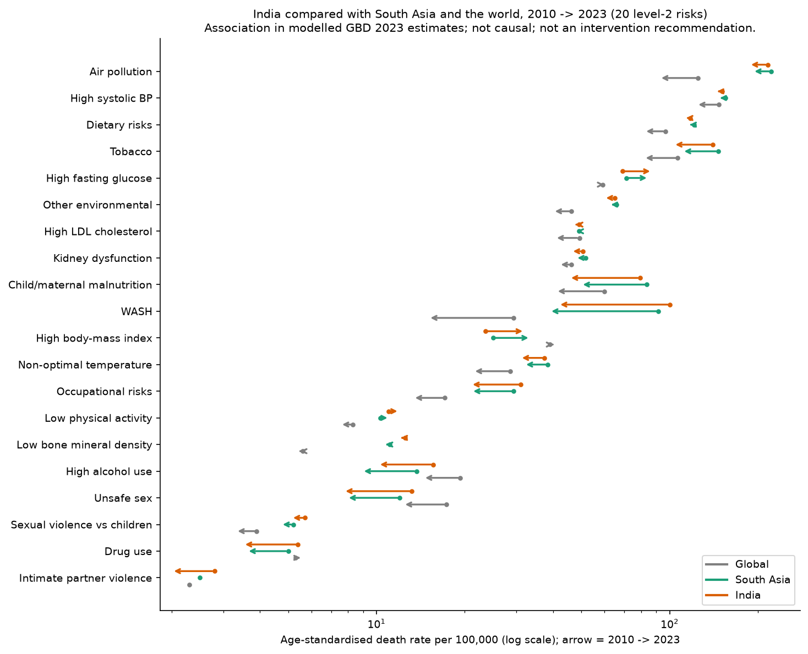
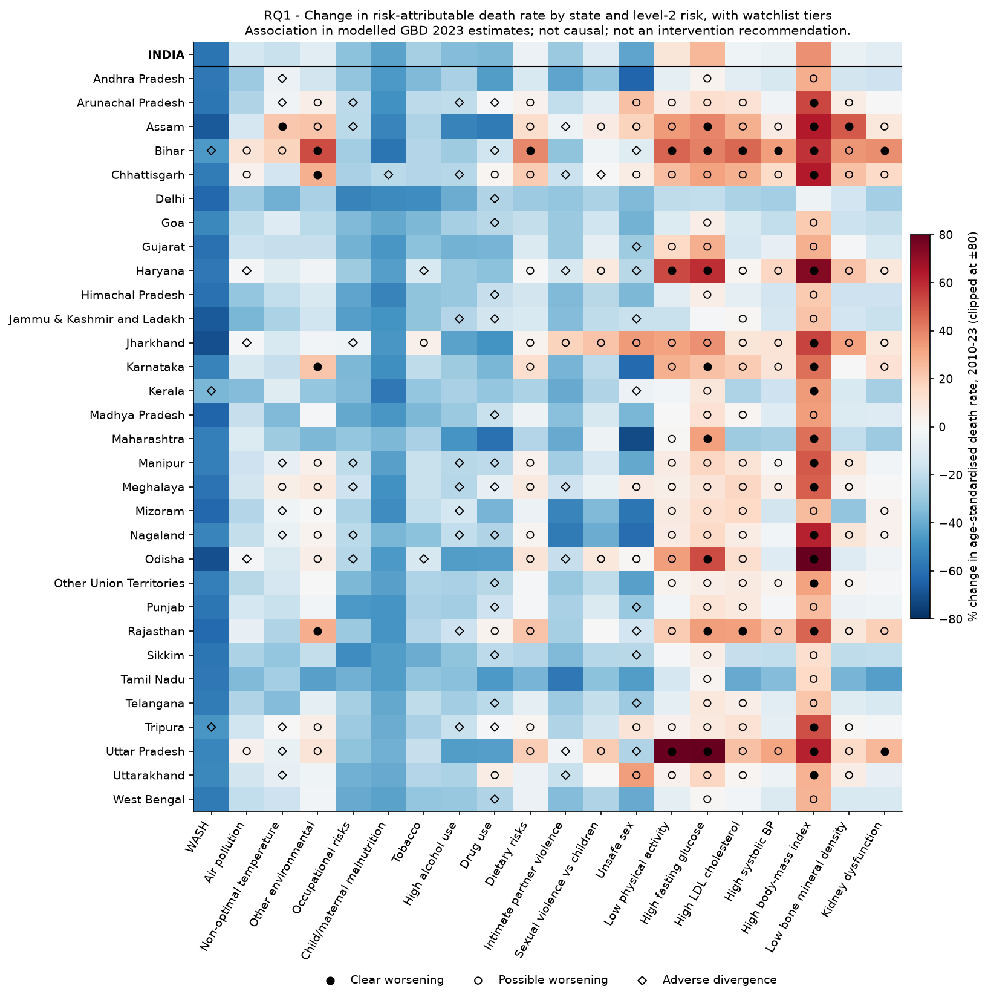
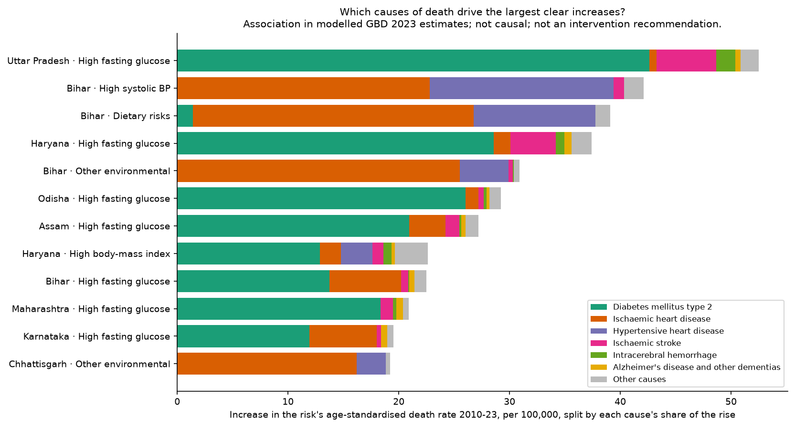
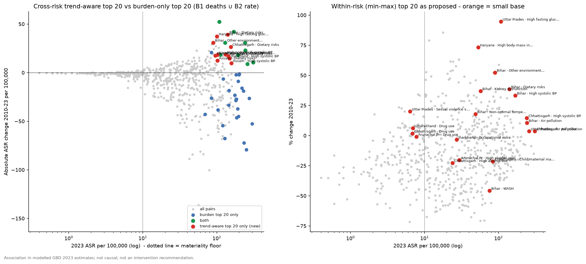
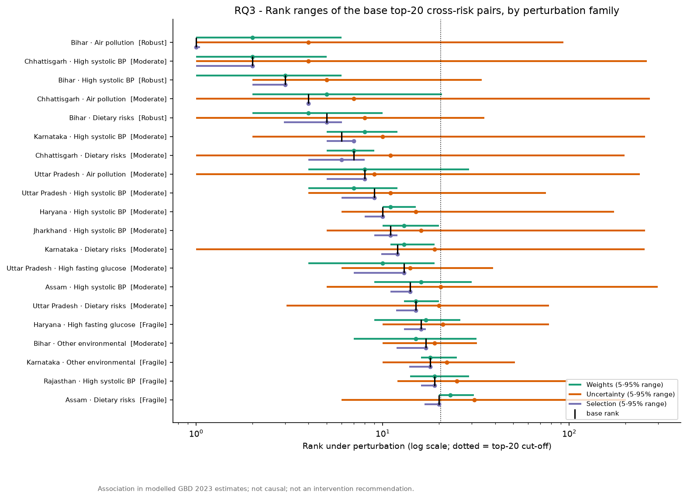
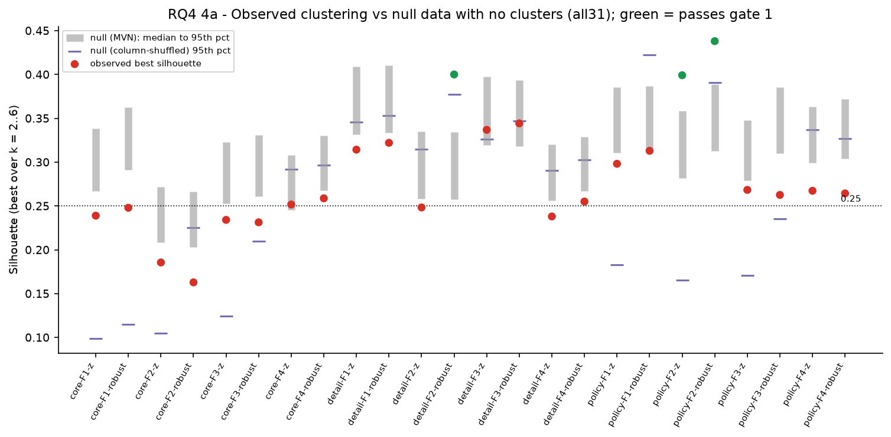
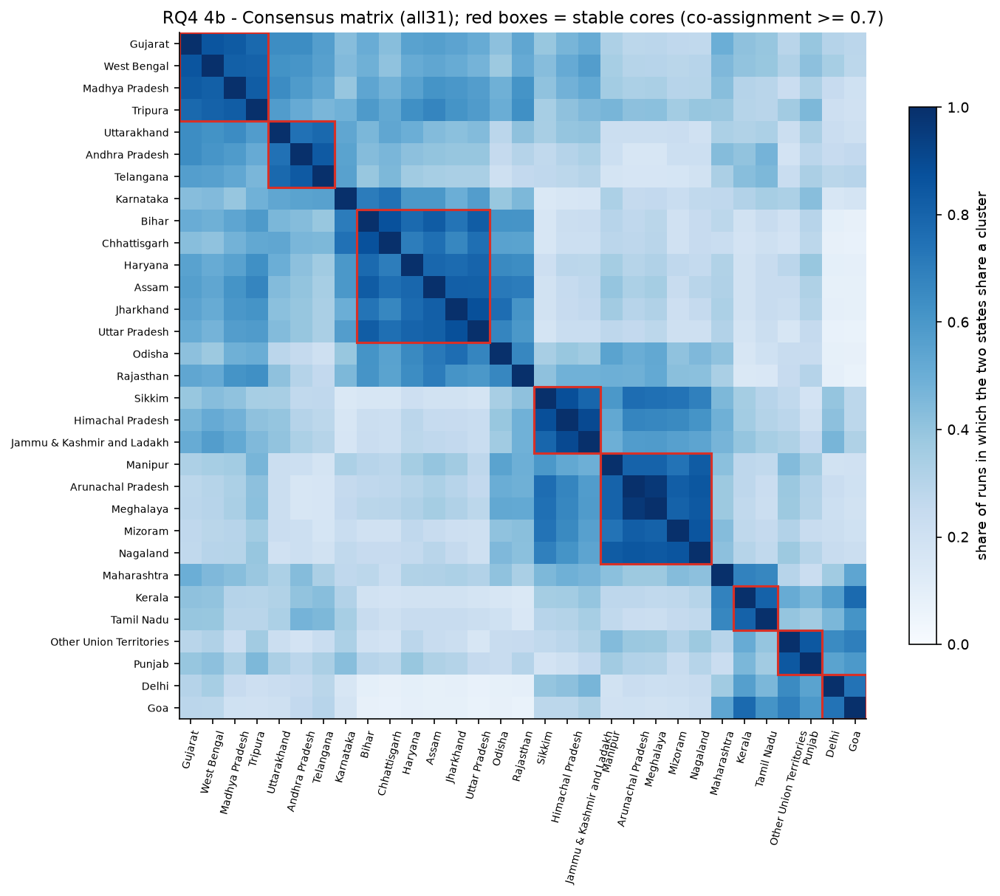
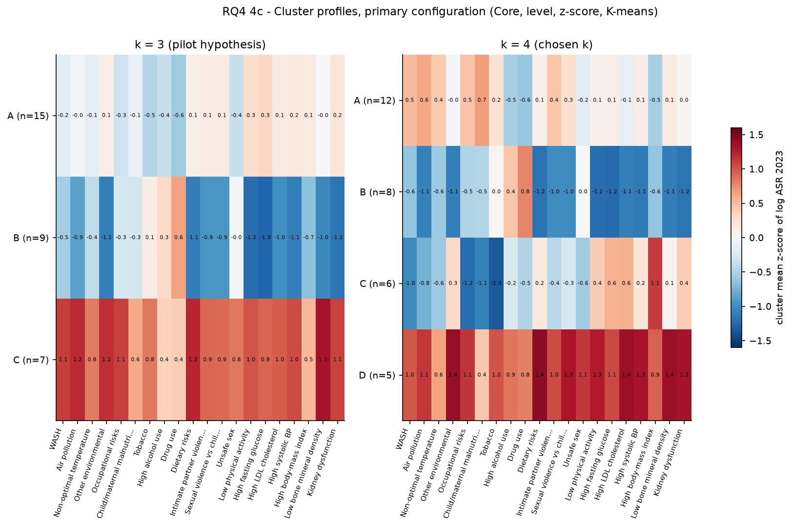
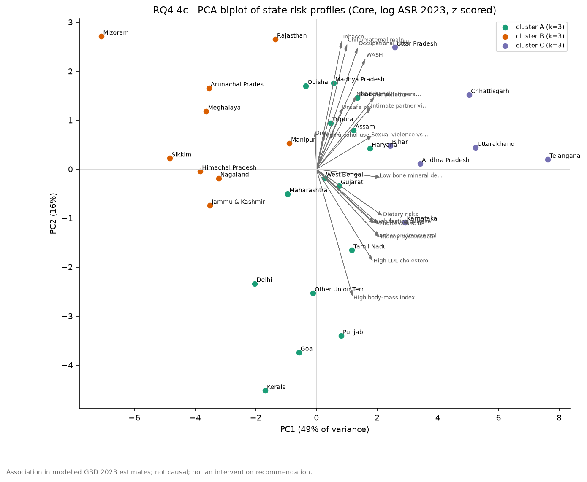
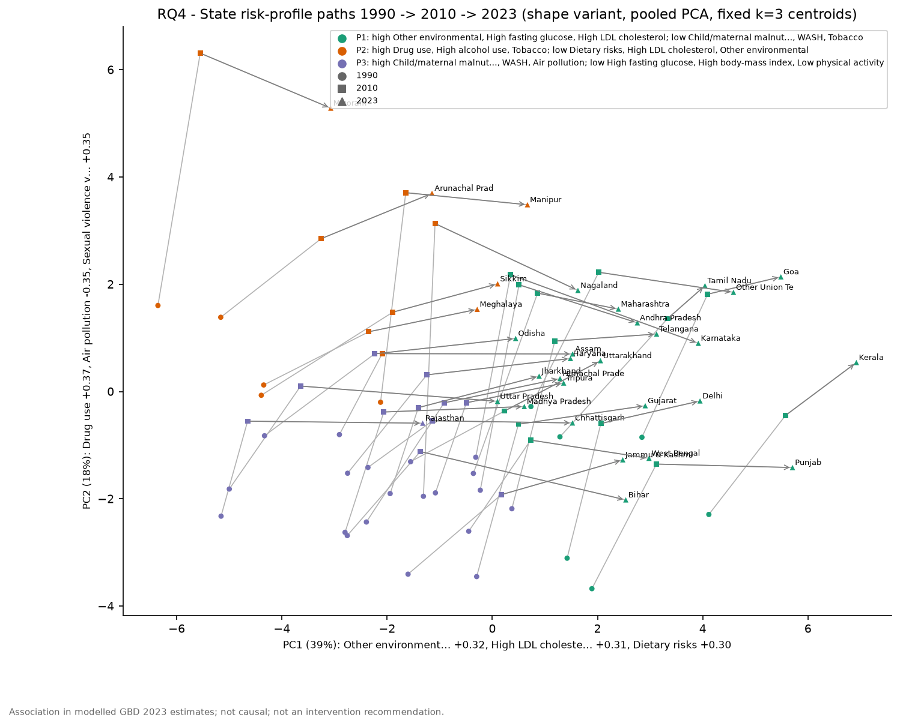

# RiskShift-India

**Which health risks are getting worse in Indian states, and would a "most deaths" ranking miss them?**

> Data: Global Burden of Disease (GBD) 2023, table S14B. These are modelled estimates of deaths linked to risk factors, for India, its 31 state units, South Asia and the world, in 1990, 2010 and 2023. Every number below is produced by the code in this repository (`python run_all.py`). *Association in modelled GBD 2023 estimates; not causal; not an intervention recommendation.*

## The short version

1. **Most risks are improving, but metabolic risks are not.** Of 620 state-and-risk combinations, 185 got worse between 2010 and 2023. In **41** of them the rise is clear even after allowing for uncertainty. High body-mass index (BMI) and high blood sugar account for 26 of those 41.
2. **Type 2 diabetes drives most of the rise.** It is the biggest single cause of death in 27 of the 41 clear increases.
3. **India is moving the opposite way to the world on metabolic risks.** India's death rate rose for physical inactivity (+10%), high blood sugar (+27%), high BMI (+37%). Over the same period, the world's changed by -9%, +1%, +4%. In 15 state cases, the rate clearly rose while the world's fell.
4. **Looking at trends changes the priority list.** Rank by "current burden plus how fast it is worsening" and 11 of the top 20 are cases that neither a deaths ranking nor a death-rate ranking puts in its top 20. 4 of those are clear, sizeable increases. That meets the success test we set in advance.
5. **The top of the list is only partly certain.** The ranking barely changes when the scoring weights or the risks included change. GBD's own uncertainty moves it more. Of the top 20, **3 are robust**, 13 moderately stable and 4 fragile.
6. **States do not fall into neat groups.** They sit on a continuous spectrum. 21 of the 24 ways we tried to group them gave the same answer: "no real clusters". A few small sets of states do consistently look alike.
7. **The clearest pattern is change over time.** In 1990, most states' risk mix was dominated by malnutrition, unsafe water and air pollution. By 2023, most were dominated by metabolic and diet-related risks such as blood sugar and cholesterol.

## How to read this report

| Term | What it means here |
| --- | --- |
| **Risk factor** | Something that raises the chance of dying early, such as high blood pressure, smoking or air pollution. |
| **Attributable deaths** | Deaths GBD's models link to a risk factor. They are estimates, not counted death certificates. |
| **Death rate (ASR)** | Attributable deaths per 100,000 people, *age-standardised*: adjusted so that states with older or younger populations can be compared fairly. |
| **Uncertainty interval (UI)** | GBD's range of plausible values (95%). A *clear* rise is one where even the low end of the range is above zero. |
| **pp (percentage points)** | The difference between two percentages. A state rate down 5% while India's is down 20% is 15 pp worse than India. |
| **Level-2 risks** | GBD groups risks into a tree. We mainly use the 20 broad, non-overlapping risks on level 2 (for example "Tobacco", "Air pollution", "High BMI"). Deaths from different risks overlap, so they are never added up. |

The analysis covers **31 state units** ("Other Union Territories" is a combined unit, and every result was re-checked without it), **20 broad risks**, 27 more detailed risks, **3 years** (1990, 2010, 2023), and India, South Asia and the world as benchmarks.

## 1. India compared with the world

India's death rate is higher than the world's for **16 of 20** broad risks. The biggest gaps are unsafe water and sanitation (2.8× the world rate), low bone density (2.2× the world rate), air pollution (2.0× the world rate), physical inactivity (1.6× the world rate). India is close to the South Asia average on almost every risk.

Each arrow runs from 2010 to 2023. Arrows pointing right mean the death rate went up.

| Risk | World 2023 | South Asia 2023 | India 2023 | World change % | India change % | States above world rate (of 31) | Trend |
| --- | --- | --- | --- | --- | --- | --- | --- |
| Air pollution | 92.0 | 191.3 | 186.2 | -26.4 | -13.8 | 29 | India improving slower |
| High systolic blood pressure | 123.1 | 145.8 | 142.8 | -16.4 | -5.6 | 19 | India improving slower |
| Dietary risks | 81.7 | 115.1 | 112.0 | -15.4 | -4.9 | 24 | India improving slower |
| Tobacco | 81.4 | 110.1 | 102.8 | -23.7 | -26.7 | 20 | India improving faster |
| High fasting plasma glucose | 59.7 | 85.1 | 87.4 | 1.1 | 26.7 | 22 | **India up, world flat or down** |
| Other environmental risks | 39.9 | 62.0 | 59.6 | -13.8 | -8.2 | 22 | India improving slower |
| High LDL cholesterol | 40.5 | 48.3 | 47.2 | -17.7 | -3.6 | 16 | India improving slower |
| Kidney dysfunction | 41.8 | 47.6 | 46.0 | -9.4 | -9.0 | 18 | India improving slower |
| Child and maternal malnutrition | 40.8 | 49.7 | 45.3 | -31.7 | -42.9 | 8 | India improving faster |
| Unsafe water, sanitation, and handwashing | 15.0 | 38.8 | 41.6 | -48.9 | -58.5 | 25 | India improving faster |
| High body-mass index | 40.7 | 33.6 | 32.1 | 4.2 | 36.7 | 8 | **both up, India much faster** |
| Non-optimal temperature | 21.3 | 31.8 | 30.8 | -25.5 | -17.6 | 16 | India improving slower |
| Occupational risks | 13.3 | 21.0 | 20.9 | -22.6 | -32.8 | 26 | India improving faster |
| Low physical activity | 7.5 | 11.1 | 12.0 | -9.4 | 9.5 | 23 | **India up, world flat or down** |
| Low bone mineral density | 5.5 | 10.6 | 11.9 | -1.2 | -5.1 | 30 | India improving faster |
| High alcohol use | 14.4 | 8.9 | 10.1 | -25.5 | -35.0 | 11 | India improving faster |
| Unsafe sex | 12.3 | 7.9 | 7.7 | -28.9 | -41.9 | 5 | India improving faster |
| Sexual violence against children and bullying | 3.3 | 4.7 | 5.1 | -13.4 | -10.1 | 22 | India improving slower |
| Drug use | 5.6 | 3.6 | 3.5 | 5.1 | -35.9 | 10 | India improving faster |
| Intimate partner violence | 1.7 | 1.8 | 2.0 | -25.9 | -29.4 | 15 | India improving faster |

*Rates are deaths per 100,000, age-standardised. Changes are 2010 to 2023.*

Among the more detailed risks, India rose while the world fell for: Ambient particulate matter pollution (India +52%, world -6%); Ambient ozone pollution (India +35%, world -10%); Chewing tobacco (India +6%, world -2%); Diet high in processed meat (India +50%, world -13%).

## 2. Where are things getting worse? (Question 1)

For every state and every broad risk, we compared the 2023 death rate with 2010 and put each combination in one of three groups:

- **Clear worsening**: the rate went up, and GBD's uncertainty range for the change is entirely above zero. **41 cases.**
- **Possible worsening**: the rate went up, but the uncertainty range includes "no change". **144 cases.**
- **Falling behind India**: the rate fell, but by at least 10 percentage points less than India's fell. **67 cases.**

The remaining 368 combinations improved in line with, or faster than, India.

*How to read the map: red means the death rate rose from 2010 to 2023 and blue means it fell. ● = clear worsening, ○ = possible worsening, ◇ = falling behind India.* The red block on the right is the metabolic risks: BMI, blood sugar, cholesterol, physical activity and blood pressure. It shows up in almost every state.

**Number of states in each group, by risk:**

| Risk | Clear worsening | Possible worsening | Falling behind India | Improving normally |
| --- | --- | --- | --- | --- |
| High body-mass index | 18 | 12 | 0 | 1 |
| High fasting plasma glucose | 8 | 21 | 0 | 2 |
| Other environmental risks | 4 | 9 | 0 | 18 |
| Low physical activity | 3 | 16 | 0 | 12 |
| High LDL cholesterol | 2 | 19 | 0 | 10 |
| Kidney dysfunction | 2 | 8 | 0 | 21 |
| Dietary risks | 1 | 13 | 0 | 17 |
| Low bone mineral density | 1 | 13 | 0 | 17 |
| High systolic blood pressure | 1 | 10 | 0 | 20 |
| Non-optimal temperature | 1 | 2 | 8 | 20 |
| Unsafe sex | 0 | 8 | 10 | 13 |
| Sexual violence against children and bullying | 0 | 5 | 1 | 25 |
| Air pollution | 0 | 3 | 3 | 25 |
| Drug use | 0 | 3 | 16 | 12 |
| Intimate partner violence | 0 | 1 | 7 | 23 |
| Tobacco | 0 | 1 | 2 | 28 |
| Child and maternal malnutrition | 0 | 0 | 1 | 30 |
| High alcohol use | 0 | 0 | 9 | 22 |
| Occupational risks | 0 | 0 | 7 | 24 |
| Unsafe water, sanitation, and handwashing | 0 | 0 | 3 | 28 |

**The 15 largest clear increases** (by how much the death rate rose):

| State | Risk | Rate 2010 | Rate 2023 | Change % | Low end of range % | India change % |
| --- | --- | --- | --- | --- | --- | --- |
| Uttar Pradesh | High fasting plasma glucose | 55.6 | 108.1 | 94.6 | 26.7 | 26.7 |
| Bihar | High systolic blood pressure | 126.9 | 169.0 | 33.2 | 4.5 | -5.6 |
| Bihar | Dietary risks | 101.6 | 140.7 | 38.5 | 12.7 | -4.9 |
| Haryana | High fasting plasma glucose | 63.4 | 100.8 | 58.9 | 16.5 | 26.7 |
| Bihar | Other environmental risks | 59.0 | 89.9 | 52.2 | 23.1 | -8.2 |
| Odisha | High fasting plasma glucose | 55.9 | 85.1 | 52.4 | 2.1 | 26.7 |
| Assam | High fasting plasma glucose | 69.9 | 97.1 | 38.9 | 4.9 | 26.7 |
| Haryana | High body-mass index | 30.8 | 53.4 | 73.2 | 19.0 | 36.7 |
| Bihar | High fasting plasma glucose | 56.3 | 78.8 | 40.0 | 10.9 | 26.7 |
| Maharashtra | High fasting plasma glucose | 64.0 | 84.9 | 32.6 | 1.5 | 26.7 |
| Karnataka | High fasting plasma glucose | 83.1 | 102.6 | 23.4 | 0.9 | 26.7 |
| Chhattisgarh | Other environmental risks | 68.0 | 87.2 | 28.2 | 1.1 | -8.2 |
| Karnataka | Other environmental risks | 83.4 | 101.7 | 22.0 | 3.4 | -8.2 |
| Bihar | Kidney dysfunction | 42.0 | 57.5 | 36.9 | 11.0 | -9.0 |
| Bihar | High LDL cholesterol | 33.5 | 48.9 | 46.0 | 16.2 | -3.6 |

### What is behind the increases?

GBD also splits each risk's deaths by cause of death. For each clear increase, we looked at which diseases account for the rise.

Blood-sugar and BMI increases come mostly from **type 2 diabetes**. Blood-pressure, diet and "other environmental" (mainly lead exposure) increases come mostly from **heart disease** (ischaemic and hypertensive).

At national level, India's rising risks break down as follows:

| Risk (India) | Main causes of the rise |
| --- | --- |
| Low physical activity | Diabetes mellitus type 2 (+2.0/100k, 87% of the rise); Ischaemic stroke (+0.1/100k, 4% of the rise); Colon and rectum cancer (+0.1/100k, 4% of the rise) |
| High fasting plasma glucose | Diabetes mellitus type 2 (+18.5/100k, 89% of the rise); Ischaemic stroke (+1.1/100k, 5% of the rise); Alzheimer's disease and other dementias (+0.4/100k, 2% of the rise) |
| High body-mass index | Diabetes mellitus type 2 (+5.9/100k, 61% of the rise); Hypertensive heart disease (+1.4/100k, 15% of the rise); Ischaemic heart disease (+0.8/100k, 8% of the rise) |

### Rising in India while falling worldwide

15 state cases rose clearly while the world's rate for the same risk fell:

| State | Risk | Rate 2023 | State change % | World change % | × world rate |
| --- | --- | --- | --- | --- | --- |
| Uttar Pradesh | Low physical activity | 11.5 | 79.1 | -9.4 | 1.5 |
| Haryana | Low physical activity | 10.5 | 52.8 | -9.4 | 1.4 |
| Bihar | Other environmental risks | 89.9 | 52.2 | -13.8 | 2.3 |
| Assam | Low bone mineral density | 12.3 | 49.2 | -1.2 | 2.2 |
| Bihar | Low physical activity | 10.4 | 46.5 | -9.4 | 1.4 |
| Bihar | High LDL cholesterol | 48.9 | 46.0 | -17.7 | 1.2 |
| Bihar | Dietary risks | 140.7 | 38.5 | -15.4 | 1.7 |
| Bihar | Kidney dysfunction | 57.5 | 36.9 | -9.4 | 1.4 |
| Bihar | High systolic blood pressure | 169.0 | 33.2 | -16.4 | 1.4 |
| Rajasthan | High LDL cholesterol | 38.4 | 32.9 | -17.7 | 0.9 |
| Rajasthan | Other environmental risks | 31.0 | 28.9 | -13.8 | 0.8 |
| Chhattisgarh | Other environmental risks | 87.2 | 28.2 | -13.8 | 2.2 |
| Uttar Pradesh | Kidney dysfunction | 43.0 | 26.6 | -9.4 | 1.0 |
| Karnataka | Other environmental risks | 101.7 | 22.0 | -13.8 | 2.5 |
| Assam | Non-optimal temperature | 19.2 | 21.8 | -25.5 | 0.9 |

**Worth knowing:**

- 26 watchlist cases start from a very small rate (under 5 per 100,000), so a large percentage rise can still mean few deaths. The full tables flag them.
- The "falling behind India" group depends on the cut-off: 5, 10 and 15 pp give 123, 67 and 29 cases. The clear and possible groups do not change.
- The detailed risks show what sits inside the broad ones. Outdoor air pollution rose in 26 states while household air pollution fell almost everywhere. That is why "air pollution" as a whole looks like it is improving.

Full lists, with a one-line reason for every case: [`rq1_watchlist_core.csv`](../outputs/tables/rq1_watchlist_core.csv) and [`rq1_watchlist_detail.csv`](../outputs/tables/rq1_watchlist_detail.csv).

## 3. Does looking at trends change who is at the top? (Question 2)

We compared three ways of ranking all 620 state-and-risk combinations:

| Ranking | What it rewards |
| --- | --- |
| **A. Most deaths** | Big states with many deaths (2023 attributable deaths). |
| **B. Highest death rate** | The highest 2023 rate per 100,000. |
| **C. Trend-aware (RiskShift)** | 40% current rate + 35% how much the rate rose + 25% how much worse it did than India. A combination needs a rate of at least 10 per 100,000 to qualify, so tiny risks cannot top the list. |

**The three top-20 lists side by side** (★ = in the trend-aware list only):

| # | A. Most deaths | B. Highest rate | C. Trend-aware |
| --- | --- | --- | --- |
| 1 | Uttar Pradesh · Air pollution | Chhattisgarh · Air pollution | Bihar · Air pollution |
| 2 | Uttar Pradesh · Tobacco | Uttarakhand · Air pollution | Chhattisgarh · High systolic blood pressure |
| 3 | Uttar Pradesh · High systolic blood pressure | Telangana · High systolic blood pressure | Bihar · High systolic blood pressure |
| 4 | Uttar Pradesh · Dietary risks | Uttar Pradesh · Air pollution | Chhattisgarh · Air pollution |
| 5 | Maharashtra · Air pollution | Telangana · Air pollution | **Bihar · Dietary risks** ★ |
| 6 | Uttar Pradesh · Child and maternal malnutrition | Bihar · Air pollution | Karnataka · High systolic blood pressure |
| 7 | Uttar Pradesh · High fasting plasma glucose | Chhattisgarh · High systolic blood pressure | **Chhattisgarh · Dietary risks** ★ |
| 8 | West Bengal · Air pollution | Uttarakhand · Tobacco | Uttar Pradesh · Air pollution |
| 9 | Bihar · Air pollution | Telangana · Dietary risks | Uttar Pradesh · High systolic blood pressure |
| 10 | West Bengal · High systolic blood pressure | Rajasthan · Air pollution | **Haryana · High systolic blood pressure** ★ |
| 11 | Madhya Pradesh · Air pollution | Jharkhand · Air pollution | **Jharkhand · High systolic blood pressure** ★ |
| 12 | Maharashtra · High systolic blood pressure | Haryana · Air pollution | **Karnataka · Dietary risks** ★ |
| 13 | Rajasthan · Air pollution | Madhya Pradesh · Air pollution | Uttar Pradesh · High fasting plasma glucose |
| 14 | West Bengal · Dietary risks | Uttarakhand · High systolic blood pressure | **Assam · High systolic blood pressure** ★ |
| 15 | Tamil Nadu · High systolic blood pressure | Karnataka · High systolic blood pressure | Uttar Pradesh · Dietary risks |
| 16 | Maharashtra · Dietary risks | Tripura · Air pollution | **Haryana · High fasting plasma glucose** ★ |
| 17 | Bihar · High systolic blood pressure | West Bengal · Air pollution | **Bihar · Other environmental risks** ★ |
| 18 | Maharashtra · High fasting plasma glucose | Karnataka · Air pollution | **Karnataka · Other environmental risks** ★ |
| 19 | West Bengal · Tobacco | Punjab · High systolic blood pressure | **Rajasthan · High systolic blood pressure** ★ |
| 20 | Karnataka · High systolic blood pressure | Assam · Air pollution | **Assam · Dietary risks** ★ |

- The trend-aware list shares **7** cases with the deaths list and **5** with the rate list.
- **11 cases are new**, and **4** of them are *clear* increases. Before seeing any results, we said the method succeeds if at least 3 new cases are clear, sizeable increases. **Result: met.**
- None of the new cases is a tiny or low-burden risk (0 small-base, 0 below the size cut-off). The novelty comes from real, sizeable change.

**Why each new case was flagged:**

| State | Risk | Question 1 group | Rate 2023 | Rise since 2010 (per 100k) | Strongest signals (percentile among all 620) |
| --- | --- | --- | --- | --- | --- |
| Bihar | Dietary risks | Clear worsening | 140.7 | 39.1 | worsening top 1% (+39.1/100k since 2010); divergence top 2% (+44.9/100k vs India's change); rate top 8% (ASR 140.7) |
| Chhattisgarh | Dietary risks | Possible worsening | 154.6 | 26.5 | worsening top 2% (+26.5/100k since 2010); divergence top 4% (+32.3/100k vs India's change); rate top 6% (ASR 154.6) |
| Haryana | High systolic blood pressure | Possible worsening | 131.9 | 18.7 | worsening top 4% (+18.7/100k since 2010); divergence top 5% (+27.1/100k vs India's change); rate top 9% (ASR 131.9) |
| Jharkhand | High systolic blood pressure | Possible worsening | 148.2 | 14.7 | worsening top 6% (+14.7/100k since 2010); rate top 6% (ASR 148.2); divergence top 7% (+23.1/100k vs India's change) |
| Karnataka | Dietary risks | Possible worsening | 143.8 | 17.1 | worsening top 5% (+17.1/100k since 2010); divergence top 7% (+22.9/100k vs India's change); rate top 7% (ASR 143.8) |
| Assam | High systolic blood pressure | Possible worsening | 156.8 | 9.8 | rate top 5% (ASR 156.8); worsening top 8% (+9.8/100k since 2010); divergence top 9% (+18.2/100k vs India's change) |
| Haryana | High fasting plasma glucose | Clear worsening | 100.8 | 37.4 | worsening top 1% (+37.4/100k since 2010); divergence top 8% (+19.0/100k vs India's change); rate top 16% (ASR 100.8) |
| Bihar | Other environmental risks | Clear worsening | 89.9 | 30.9 | worsening top 2% (+30.9/100k since 2010); divergence top 3% (+36.2/100k vs India's change); rate top 19% (ASR 89.9) |
| Karnataka | Other environmental risks | Clear worsening | 101.7 | 18.3 | worsening top 4% (+18.3/100k since 2010); divergence top 6% (+23.6/100k vs India's change); rate top 16% (ASR 101.7) |
| Rajasthan | High systolic blood pressure | Possible worsening | 95.6 | 17.6 | worsening top 5% (+17.6/100k since 2010); divergence top 6% (+26.0/100k vs India's change); rate top 17% (ASR 95.6) |
| Assam | Dietary risks | Possible worsening | 101.8 | 12.6 | worsening top 6% (+12.6/100k since 2010); divergence top 8% (+18.4/100k vs India's change); rate top 16% (ASR 101.8) |

**A warning about the original scoring idea.** The proposal suggested scaling each risk from 0 to 1 separately (the right-hand chart). That makes the worst state for *every* risk look urgent, however small the risk. 4 of that list's top 20 have a death rate below 10 per 100,000 (for example drug use in Uttarakhand). We therefore use the per-risk version only to rank states *within* one risk, and the trend-aware score above to compare across risks.

**How different are the rankings overall?**

| Method | Top N | Shared with A | Shared with B | New cases | …of which clear rises | …tiny base | …below size cut-off | Rank correlation with B |
| --- | --- | --- | --- | --- | --- | --- | --- | --- |
| Per-risk scaling (proposal) | 10 | 2 | 2 | 7 | 2 | 0 | 1 | 0.23 |
| Per-risk scaling (proposal) | 20 | 4 | 4 | 14 | 4 | 0 | 4 | 0.23 |
| Per-risk scaling (proposal) | 30 | 6 | 5 | 22 | 6 | 2 | 6 | 0.23 |
| Trend-aware (used) | 10 | 3 | 4 | 5 | 2 | 0 | 0 | 0.55 |
| Trend-aware (used) | 20 | 7 | 5 | 11 | 4 | 0 | 0 | 0.55 |
| Trend-aware (used) | 30 | 9 | 7 | 18 | 6 | 0 | 0 | 0.55 |

*Rank correlation runs from 1 (identical order) to 0 (unrelated). A value around 0.5 means the trend-aware ranking keeps the broad picture of burden but reorders it a lot.*

Per-risk state rankings: [`rq2_within_risk_state_rankings.csv`](../outputs/tables/rq2_within_risk_state_rankings.csv). All scores: [`rq2_scores_core.csv`](../outputs/tables/rq2_scores_core.csv).

## 4. Can we trust the ranking? (Question 3)

We re-ran the trend-aware ranking thousands of times, changing one thing at a time:

| Test | What we changed | Runs |
| --- | --- | --- |
| **Weights** | The 40/35/25 split, drawn at random, plus extremes such as "rate only" or "trend only". | 1,005 |
| **GBD uncertainty** | Each rate and each change, redrawn within GBD's uncertainty range. Also all-low and all-high values. | 1,002 |
| **Risk choice** | One risk dropped at a time, the policy-focused risk list, and Other UTs removed. | 22 |

A case is **Robust** if it stays in the top 20 in at least 80% of runs, **Moderate** at 50–80%, and **Fragile** below 50%. Its overall label is its weakest result across the three tests.

| # | State | Risk | Stays in top 20: weights | …uncertainty | …risk choice | Overall |
| --- | --- | --- | --- | --- | --- | --- |
| 1 | Bihar | Air pollution | 100% | 83% | 100% | Robust |
| 2 | Chhattisgarh | High systolic blood pressure | 100% | 78% | 100% | Moderate |
| 3 | Bihar | High systolic blood pressure | 100% | 93% | 100% | Robust |
| 4 | Chhattisgarh | Air pollution | 95% | 64% | 100% | Moderate |
| 5 | Bihar | Dietary risks | 100% | 82% | 100% | Robust |
| 6 | Karnataka | High systolic blood pressure | 99% | 66% | 100% | Moderate |
| 7 | Chhattisgarh | Dietary risks | 100% | 69% | 100% | Moderate |
| 8 | Uttar Pradesh | Air pollution | 89% | 63% | 100% | Moderate |
| 9 | Uttar Pradesh | High systolic blood pressure | 99% | 79% | 100% | Moderate |
| 10 | Haryana | High systolic blood pressure | 99% | 67% | 100% | Moderate |
| 11 | Jharkhand | High systolic blood pressure | 95% | 60% | 100% | Moderate |
| 12 | Karnataka | Dietary risks | 97% | 52% | 100% | Moderate |
| 13 | Uttar Pradesh | High fasting plasma glucose | 96% | 79% | 100% | Moderate |
| 14 | Assam | High systolic blood pressure | 72% | 50% | 100% | Moderate |
| 15 | Uttar Pradesh | Dietary risks | 97% | 51% | 100% | Moderate |
| 16 | Haryana | High fasting plasma glucose | 75% | 49% | 100% | Fragile |
| 17 | Bihar | Other environmental risks | 81% | 55% | 100% | Moderate |
| 18 | Karnataka | Other environmental risks | 78% | 44% | 100% | Fragile |
| 19 | Rajasthan | High systolic blood pressure | 61% | 34% | 100% | Fragile |
| 20 | Assam | Dietary risks | 9% | 32% | 100% | Fragile |

*Each line shows where a case ranked in the middle 90% of runs. Lines that cross the dotted line mean the case sometimes drops out of the top 20.*

**What this tells us:**
- **Weights and risk choice hardly matter.** Every top-20 case survives the risk-choice test, and 15 of 20 are robust to the weights.
- **GBD's uncertainty is the real limit.** The 2010–2023 change ranges are wide, so many cases drop in and out. Only 3 cases are robust to it: Bihar air pollution, Bihar dietary risks, Bihar high blood pressure.
- The overall order stays similar: the typical rank correlation with the original ranking is 0.81 under weight changes and 0.71 under uncertainty.
- This is a deliberately harsh test. IHME does not publish the linked simulation draws, so each number was varied independently, which probably exaggerates the instability.

For the Question 1 groups, *clear worsening* labels never change under uncertainty (0% of runs), because they are already defined by the uncertainty range. *Falling behind India* labels change in 54% of runs, so treat that group as a softer signal.

## 5. Do states fall into groups? (Question 4)

We used clustering (K-means and three other methods) to see whether states form distinct groups with similar risk profiles. Many methods will always return groups, even from random data. So we compared each result with random "no-group" data that has the same overall shape, and only accepted groups that beat it, held together when the data were resampled, and agreed across different set-ups.

**Answer: no. States lie on a spectrum, not in separate groups.**

- We tried 24 set-ups (3 risk lists × 4 kinds of features × 2 scalings). **21 found no real groups.** 3 found weak structure, and none found robust groups.
- Only 3 of 24 beat the random comparison data, and those few disagree with each other. The typical agreement between set-ups (ARI) is 0.14, where 1 is identical and 0 is chance level.
- Most of the variation between states is one dimension, *overall burden*: high-burden states are high on most risks. It explains 49% of the differences.

*Dots are the real data. Grey bars are what random no-group data typically produce. A dot must sit above its grey bar, and above 0.25, to count as real grouping. Only a few do (green).*

**But some states consistently look alike.** Across all runs, these sets of states were placed together at least 70% of the time:

- Assam, Bihar, Chhattisgarh, Haryana, Jharkhand, Uttar Pradesh (together 79% of the time)
- Arunachal Pradesh, Manipur, Meghalaya, Mizoram, Nagaland (together 83% of the time)
- Gujarat, Madhya Pradesh, Tripura, West Bengal (together 82% of the time)
- Andhra Pradesh, Telangana, Uttarakhand (together 79% of the time)
- Himachal Pradesh, Jammu & Kashmir and Ladakh, Sikkim (together 86% of the time)
- Kerala, Tamil Nadu (together 81% of the time)
- Other Union Territories, Punjab (together 85% of the time)
- Delhi, Goa (together 74% of the time)

**A descriptive split into three profiles** (useful for comparing a state with similar states, but not a claim of distinct types):

| Group | States | What stands out (vs other states) | Members |
| --- | --- | --- | --- |
| A | 15 | Fewer deaths from drug use, tobacco, unsafe sex. | Assam, Delhi, Goa, Gujarat, Haryana, Jharkhand, Kerala, Madhya Pradesh, Maharashtra, Odisha, Other Union Territories, Punjab, Tamil Nadu, Tripura, West Bengal |
| B | 9 | Fewer deaths from high blood sugar, physical inactivity, kidney dysfunction. | Arunachal Pradesh, Himachal Pradesh, Jammu & Kashmir and Ladakh, Manipur, Meghalaya, Mizoram, Nagaland, Rajasthan, Sikkim |
| C | 7 | More deaths from low bone density, dietary risks, air pollution. | Andhra Pradesh, Bihar, Chhattisgarh, Karnataka, Telangana, Uttar Pradesh, Uttarakhand |

- The groups barely follow geography (agreement with India's Zonal Councils: ARI 0.12). The north-eastern hill states are the exception.
- Worsening cases from Question 1 are not concentrated in any one group (p = 0.31).
- Comparing each state with its own peer group, not just India, finds 6 extra cases that look fine against India but worse than similar states ([`rq4_hidden_divergence.csv`](../outputs/tables/rq4_hidden_divergence.csv)).

### How state risk profiles shifted, 1990 → 2010 → 2023

Here we compare the *mix* of risks in each state, setting overall burden aside, and track it over time. This is the strongest pattern in the data.

| Profile | 1990 | 2010 | 2023 |
| --- | --- | --- | --- |
| Traditional risks (malnutrition, unsafe water, air pollution) | 20 | 11 | 1 |
| Metabolic and diet risks | 6 | 13 | 25 |
| Drug, alcohol and tobacco | 5 | 7 | 5 |

19 of 31 states changed profile between 1990 and 2023. Kerala, Goa, Punjab, Delhi and Tamil Nadu already had the metabolic profile in 1990. Most southern and western states moved by 2010, and Bihar, Uttar Pradesh, Odisha, Jharkhand and Madhya Pradesh by 2023. Rajasthan was the only state still in the traditional profile in 2023. Five north-eastern states kept their own drug, alcohol and tobacco profile throughout.

An interactive version of this chart (a Sankey flow diagram) is in [`rq4_migration_shape_sankey.html`](../outputs/figures/rq4_migration_shape_sankey.html).

## 6. What this means

- **For screening:** ranking by deaths alone misses fast-worsening, high-rate problems in the middle of the burden table, mainly **blood pressure, diet, blood sugar and BMI in Bihar, Chhattisgarh, Karnataka, Haryana, Assam and Jharkhand**. The trend-aware list adds these without letting tiny risks crowd the top.
- **Metabolic risks are India's emerging problem.** Their death rates are rising nationally and in most states, driven by type 2 diabetes and heart disease, while the world's rates are flat or falling.
- **Be modest about exact ranks.** Use the robust cases with confidence and treat fragile ones as "worth a closer look".
- **Compare states with similar states, not with fixed types.** States sit on a spectrum, so peer comparison and the shift-over-time view are more useful than labelling clusters.

## 7. Limits

- These are **modelled estimates**, not direct counts, and only three years are available. This is not a forecast.
- Deaths linked to different risks **overlap**: high BMI acts partly through blood pressure, for example. They are never added together.
- Associations only. **Nothing here shows cause and effect** or tells anyone where to spend money.
- "Other Union Territories" combines several small territories. Every result was re-run without it, and the conclusions held.
- Two optional inputs were not supplied: GBD's socio-demographic index (SDI) groups and its evidence-strength ratings. Zonal Councils were used as the outside comparison instead.

---

## Appendix: full comparison tables

### A1. Ranking comparison, without "Other Union Territories"

| Method | Top N | Shared with A | Shared with B | New | New clear & sizeable | Jaccard vs A | Jaccard vs B | Kendall vs B |
| --- | --- | --- | --- | --- | --- | --- | --- | --- |
| Per-risk scaling (proposal) | 10 | 2 | 2 | 7 | 2 | 0.11 | 0.11 | 0.16 |
| Per-risk scaling (proposal) | 20 | 4 | 4 | 14 | 4 | 0.11 | 0.11 | 0.16 |
| Per-risk scaling (proposal) | 30 | 6 | 5 | 22 | 6 | 0.11 | 0.09 | 0.16 |
| Trend-aware (used) | 10 | 3 | 4 | 5 | 2 | 0.18 | 0.25 | 0.39 |
| Trend-aware (used) | 20 | 7 | 5 | 11 | 4 | 0.21 | 0.14 | 0.39 |
| Trend-aware (used) | 30 | 9 | 7 | 18 | 6 | 0.18 | 0.13 | 0.39 |

### A2. Stability labels by test and list length

| Top N | Test | Robust | Moderate | Fragile |
| --- | --- | --- | --- | --- |
| 10 | Weights | 8 | 1 | 1 |
| 10 | Uncertainty | 1 | 6 | 3 |
| 10 | Selection | 10 | 0 | 0 |
| 10 | overall | 1 | 6 | 3 |
| 20 | Weights | 15 | 4 | 1 |
| 20 | Uncertainty | 3 | 13 | 4 |
| 20 | Selection | 20 | 0 | 0 |
| 20 | overall | 3 | 13 | 4 |
| 30 | Weights | 21 | 6 | 3 |
| 30 | Uncertainty | 7 | 14 | 9 |
| 30 | Selection | 30 | 0 | 0 |
| 30 | overall | 7 | 14 | 9 |

| Test | Runs | Rank correlation (typical) | (worst 5%) | (worst) |
| --- | --- | --- | --- | --- |
| Weights | 1005 | 0.81 | 0.68 | 0.54 |
| Uncertainty | 1002 | 0.71 | 0.69 | 0.66 |
| Selection | 22 | 0.99 | 0.98 | 0.76 |

### A3. How often Question 1 groups change

| Change | Share of cases that change group | Cases changing in most runs |
| --- | --- | --- |
| Cut-off for 'falling behind India' set to 5 pp | 0.09 | 56 |
| Cut-off set to 15 pp | 0.06 | 38 |
| Use low end of each change range | 0.31 | 191 |
| Use high end of each change range | 0.41 | 256 |
| Random redraws within uncertainty: all cases | 0.24 | 45 |
| …watchlist cases only | 0.29 | 29 |
| …clear worsening cases | 0.00 | 0 |
| …possible worsening cases | 0.26 | 1 |
| …falling-behind-India cases | 0.54 | 28 |

### A4. Divergence cut-off sensitivity

| Group | Cut-off 5 pp | 10 pp (used) | 15 pp |
| --- | --- | --- | --- |
| Clear worsening | 41 | 41 | 41 |
| Possible worsening | 144 | 144 | 144 |
| Falling behind India | 123 | 67 | 29 |
| Improving normally | 312 | 368 | 406 |

### A5. Clustering results for all 24 set-ups (31 units)

| Set-up (risks-features-scaling) | Groups chosen | Separation (silhouette) | Random-data benchmark | Beats random? | Weakest group stability | Agreement with other set-ups | Agreement under uncertainty | Verdict |
| --- | --- | --- | --- | --- | --- | --- | --- | --- |
| core-F1-z | 4 | 0.24 | 0.34 | no | 0.70 | 0.19 | 0.68 | Gradient, not clusters |
| core-F1-robust | 4 | 0.25 | 0.36 | no | 0.71 | 0.19 | 0.65 | Gradient, not clusters |
| core-F2-z | 3 | 0.19 | 0.27 | no | 0.68 | 0.20 | 0.61 | Gradient, not clusters |
| core-F2-robust | 3 | 0.16 | 0.27 | no | 0.64 | 0.16 | 0.48 | Gradient, not clusters |
| core-F3-z | 2 | 0.23 | 0.32 | no | 0.73 | 0.04 | 0.54 | Gradient, not clusters |
| core-F3-robust | 4 | 0.23 | 0.33 | no | 0.70 | 0.10 | 0.10 | Gradient, not clusters |
| core-F4-z | 3 | 0.25 | 0.31 | no | 0.56 | 0.13 | 0.34 | Gradient, not clusters |
| core-F4-robust | 6 | 0.26 | 0.33 | no | 0.60 | 0.19 | 0.06 | Gradient, not clusters |
| detail-F1-z | 2 | 0.31 | 0.41 | no | 0.87 | 0.16 | 0.75 | Gradient, not clusters |
| detail-F1-robust | 3 | 0.32 | 0.41 | no | 0.64 | 0.19 | 0.66 | Gradient, not clusters |
| detail-F2-z | 5 | 0.25 | 0.33 | no | 0.58 | 0.13 | 0.29 | Gradient, not clusters |
| detail-F2-robust | 2 | 0.40 | 0.33 | yes | 0.65 | 0.04 | 0.48 | Partial structure |
| detail-F3-z | 6 | 0.34 | 0.40 | no | 0.67 | 0.13 | 0.24 | Gradient, not clusters |
| detail-F3-robust | 4 | 0.34 | 0.39 | no | 0.64 | 0.03 | -0.00 | Gradient, not clusters |
| detail-F4-z | 2 | 0.24 | 0.32 | no | 0.82 | 0.21 | 0.75 | Gradient, not clusters |
| detail-F4-robust | 6 | 0.26 | 0.33 | no | 0.58 | 0.17 | -0.00 | Gradient, not clusters |
| policy-F1-z | 2 | 0.30 | 0.39 | no | 0.80 | 0.11 | 0.75 | Gradient, not clusters |
| policy-F1-robust | 3 | 0.31 | 0.39 | no | 0.55 | 0.23 | 0.77 | Gradient, not clusters |
| policy-F2-z | 2 | 0.40 | 0.36 | yes | 0.62 | 0.04 | 0.58 | Partial structure |
| policy-F2-robust | 2 | 0.44 | 0.39 | yes | 0.67 | 0.04 | 0.83 | Partial structure |
| policy-F3-z | 4 | 0.27 | 0.35 | no | 0.58 | 0.15 | 0.36 | Gradient, not clusters |
| policy-F3-robust | 2 | 0.26 | 0.39 | no | 0.71 | 0.05 | 0.22 | Gradient, not clusters |
| policy-F4-z | 6 | 0.27 | 0.36 | no | 0.58 | 0.18 | 0.38 | Gradient, not clusters |
| policy-F4-robust | 6 | 0.26 | 0.37 | no | 0.51 | 0.23 | 0.37 | Gradient, not clusters |

*F1 = burden level, F2 = risk mix, F3 = change since 2010, F4 = level + change. Without Other UTs, the verdicts are Gradient, not clusters 21, Partial structure 3.*

### A6. Risk lists used

- **Broad (core) risks (20)**: Unsafe water, sanitation, and handwashing, Air pollution, Non-optimal temperature, Other environmental risks, Occupational risks, Child and maternal malnutrition, Tobacco, High alcohol use, Drug use, Dietary risks, Intimate partner violence, Sexual violence against children and bullying, Unsafe sex, Low physical activity, High fasting plasma glucose, High LDL cholesterol, High systolic blood pressure, High body-mass index, Low bone mineral density, Kidney dysfunction.
- **Detailed risks (27)**: Unsafe water source, Unsafe sanitation, No access to handwashing facility, Ambient particulate matter pollution, Household air pollution from solid fuels, Ambient ozone pollution, Low temperature, Lead exposure, Occupational particulate matter, gases, and fumes, Occupational injuries, Child growth failure, Low birth weight and short gestation, Smoking, Chewing tobacco, Secondhand smoke, Diet low in fruits, Diet low in vegetables, Diet low in legumes, Diet low in whole grains, Diet low in nuts and seeds, Diet high in processed meat, Diet low in fiber, Diet low in seafood omega-3 fatty acids, Diet low in omega-6 polyunsaturated fatty acids, Diet high in trans fatty acids, Diet high in sodium, Sexual violence against children.
- **Policy-focused risks (10)**: Ambient particulate matter pollution, Household air pollution from solid fuels, Ambient ozone pollution, Lead exposure, Smoking, High fasting plasma glucose, High LDL cholesterol, High systolic blood pressure, High body-mass index, Kidney dysfunction.

### A7. Where everything is

| What | File |
| --- | --- |
| Every choice and threshold | [`docs/rules_log.md`](rules_log.md) |
| Every column | [`docs/data_dictionary.md`](data_dictionary.md) |
| All result tables | [`outputs/tables/`](../outputs/tables) |
| All figures | [`outputs/figures/`](../outputs/figures) |
| Interactive explorer | `streamlit run app/streamlit_app.py` |
